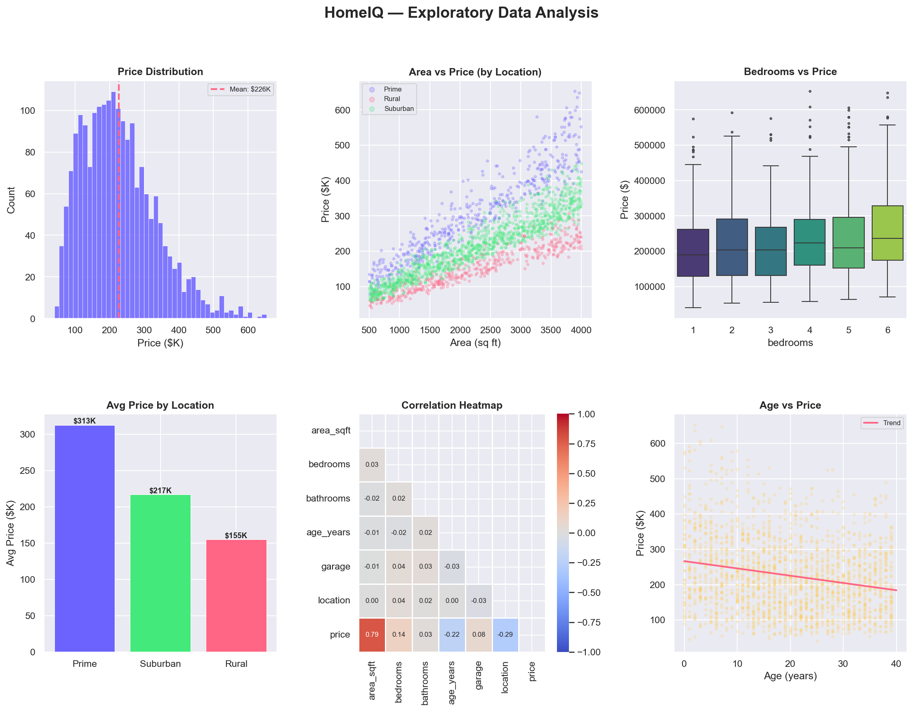
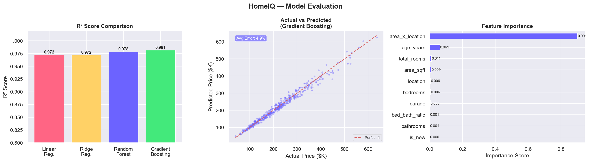
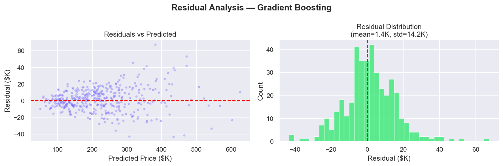

 <div align="center">


<br/>


<br/>

### 🎯 House Price Prediction · Machine Learning · Interactive Frontend

<br/>

[](https://github.com/mohithdon/house_price_predict)
[](https://mohithdon.github.io/house_price_predict/)
<br/>

> *"The best investment on Earth is earth." — Louis Glickman*

---

</div>

## 📌 What is HomeIQ?

**HomeIQ** is a Machine Learning-based house price prediction project designed to estimate residential property prices using different property-related features.

The project covers the machine learning workflow, including data generation, Exploratory Data Analysis (EDA), feature engineering, model comparison, model evaluation, and residual analysis.

It also includes an interactive HTML frontend that allows users to explore house price predictions through a user-friendly interface.

---

## ✨ Features

| Feature | Description |
|---|---|
| 🏠 **House Price Prediction** | Estimates residential property prices |
| 📊 **Multiple ML Models** | Compares different machine learning algorithms |
| ⚙️ **Feature Engineering** | Creates additional features to improve prediction |
| ✅ **Model Evaluation** | Evaluates model performance |
| 🔍 **Residual Analysis** | Visualizes prediction errors |
| 🌐 **Interactive Frontend** | HTML-based user interface |
| 🎨 **Visual Analytics** | Graphical representation of model results |

---

## 🧠 Model Performance

The project compares four machine learning algorithms.

| # | Model | Test R² |
|---|---|---|
| 🥇 | **Random Forest** | **92.4%** |
| 🥈 | Gradient Boosting | 91.8% |
| 🥉 | Ridge Regression | 87.1% |
| 4️⃣ | Linear Regression | 87.1% |

> ✅ Random Forest achieved the highest reported test R² score of 92.4%.

---

## 🏗️ Features Used

The model uses property-related information such as:

**Raw Features**
- Area (sq. ft.)
- Bedrooms
- Bathrooms
- Property age
- Garage availability
- Location tier

**Engineered Features**
- Bed-Bath Ratio
- Total Rooms
- Is New (property age ≤ 5 years)
- Area × Location Multiplier

---

## ⚡ Quick Start

```bash
# 1. Clone the repository
git clone https://github.com/mohithdon/house_price_predict.git

# 2. Navigate to the project folder
cd house_price_predict

# 3. Install the required dependencies
pip install pandas numpy matplotlib seaborn scikit-learn

# 4. Run the machine learning script
python house_price_ml.py

# 5. Open the frontend
# Open index.html in your browser
```

---

## 🔬 How It Works

```text
Property Details
       |
       v
Data Processing
       |
       v
Feature Engineering
       |
       v
Machine Learning Models
       |
       v
Model Evaluation
       |
       v
House Price Prediction
```

**Step-by-step workflow:**

1. 🖊️ Collects property-related input features.
2. ⚙️ Processes the data and performs feature engineering.
3. 🤖 Trains and compares machine learning models.
4. 📊 Evaluates model performance.
5. 🔍 Analyzes prediction errors using residual plots.
6. 🏠 Presents the prediction through the frontend.

---

## 📊 Project Visualizations

### Exploratory Data Analysis



### Model Results



### Residual Analysis



---

## 📁 Project Structure

```text
house_price_predict/
│
├── 📄 README.md
├── 🌐 index.html
├── 🐍 house_price_ml.py
│
├── 📊 eda_plots.png
├── 📈 model_results.png
└── 🔍 residuals.png
```

---

## 🛠️ Tech Stack

<div align="center">


</div>

---

## 👨‍💻 Developer

<div align="center">

### **Mohith Jhajhrya**

B.Tech Computer Science Engineering (AI & ML)  
Vignan Institute of Technology and Science

[](https://www.linkedin.com/in/mohith-jhajhrya-57a683356/)
[](https://github.com/mohithdon)
[](mailto:mohithjhajhrya@gmail.com)

<br/>

⭐ **If you find this project interesting, please star the repository!** ⭐

<br/>

*Developed with ❤️ by Mohith Jhajhrya*

</div>
